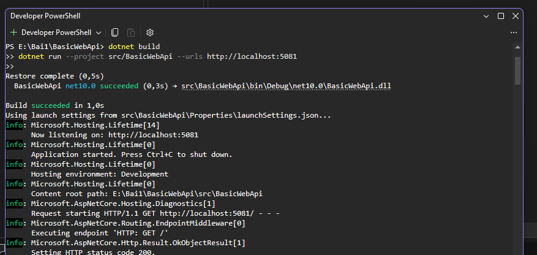
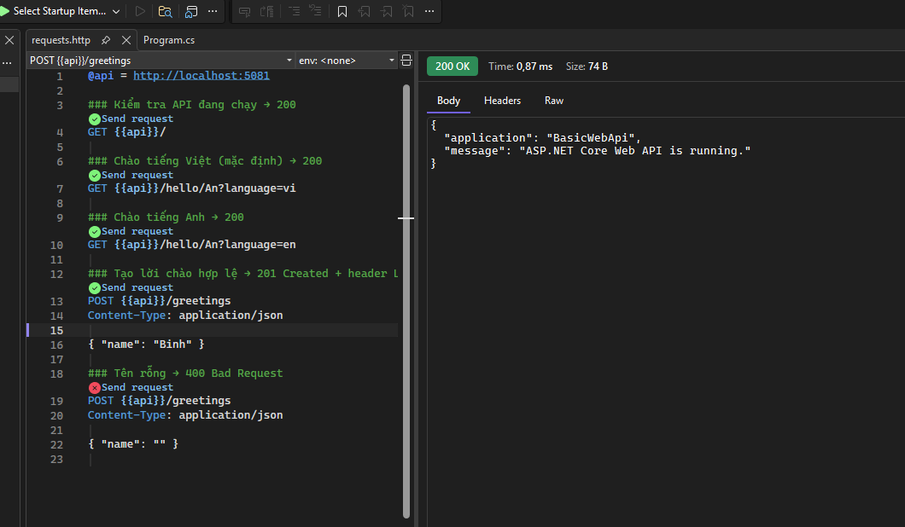
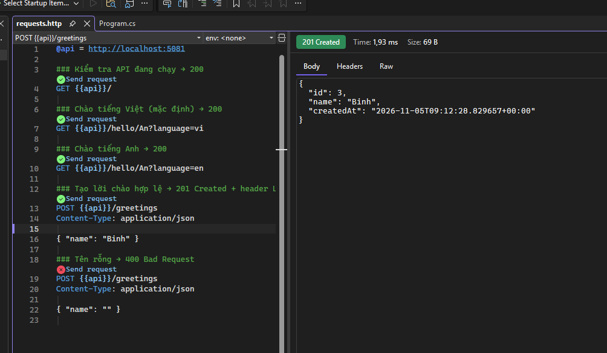
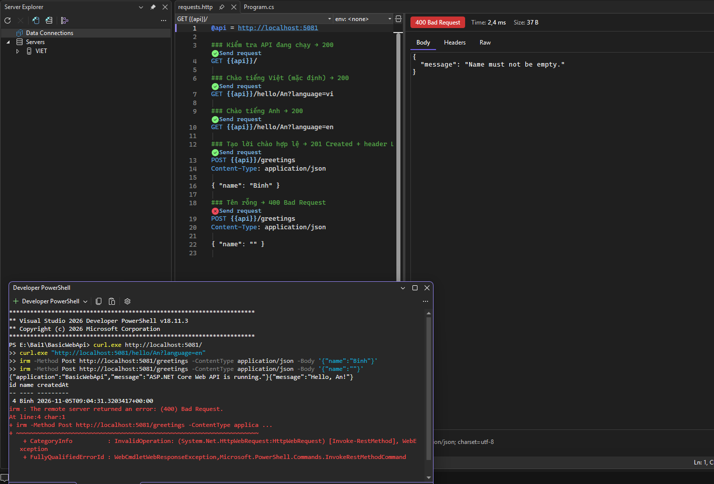
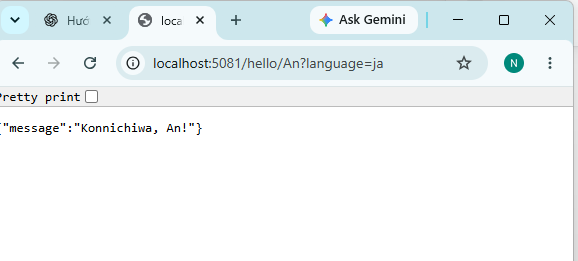
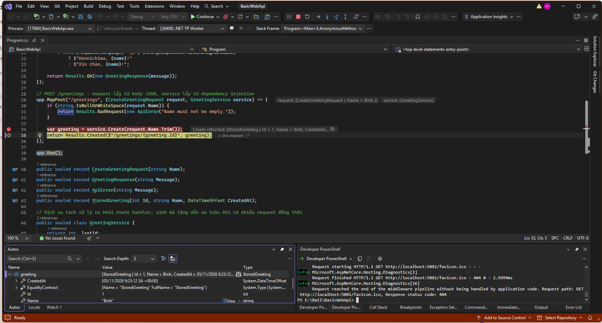

# Bài 1 - Tổng quan hệ thống và MEP

Họ tên: Hoàng Đức Việt
MSSV:DTC245200377
Lớp:CNTT K23C

## 1. Cài đặt (Bước 4)
(Ảnh chụp kết quả Bước 4)

## 2. MepDemo (Bước 7)
- Trả lời 3 câu hỏi
- Mỗi MEP 1 câu mô tả

## 3. BasicWebApi (Bước 8)
- Ảnh chụp REST Client: 200, 201, 400

### Build và chạy BasicWebApi

### Kiểm tra API — 200 OK

### Tạo lời chào hợp lệ — 201 Created

### Kiểm tra dữ liệu không hợp lệ — 400 Bad Request

### Trả lời câu hỏi mục 8.4

**1. Hai dòng `builder.Services.AddSingleton<GreetingService>()` và `var app = builder.Build();`, dòng nào phải đứng trước? Vì sao?**

Dòng `builder.Services.AddSingleton<GreetingService>();` phải đứng trước `var app = builder.Build();`. Cần đăng ký dịch vụ trước khi xây dựng ứng dụng để hệ thống dependency injection (DI) tạo bộ cung cấp dịch vụ có chứa `GreetingService`. Khi endpoint POST cần tham số `GreetingService service`, DI sẽ cung cấp đối tượng đã đăng ký. Sau khi gọi `Build()`, danh sách đăng ký dịch vụ trở thành chỉ đọc, nên không thể gọi `AddSingleton` để bổ sung dịch vụ nữa. `Singleton` nghĩa là một đối tượng dịch vụ được dùng chung trong suốt vòng đời ứng dụng.

**2. Trong `/hello/{name}?language=en`, tham số `name` lấy từ đâu, `language` lấy từ đâu?**

Tham số `name` lấy từ đường dẫn URL (route), tại vị trí `{name}`; tham số `language` lấy từ chuỗi truy vấn (query string), sau dấu `?`. Ví dụ, với `/hello/An?language=en`, giá trị `name` là `An` và `language` là `en`, nên API trả lời `Hello, An!`. Trong mã hiện tại, nếu không truyền `language` hoặc giá trị khác `en` thì API trả lời bằng tiếng Việt.

**3. Vì sao POST hợp lệ trả `Results.Created` (201) chứ không phải `Results.Ok` (200)?**

POST `/greetings` hợp lệ tạo một lời chào mới có `id`, `name` và `createdAt`, nên trả `201 Created` để thể hiện tài nguyên mới đã được tạo. `Results.Created($"/greetings/{greeting.Id}", greeting)` còn trả dữ liệu lời chào trong body và đặt header `Location` thành đường dẫn của tài nguyên mới, ví dụ `/greetings/3`. `200 OK` chỉ cho biết yêu cầu thành công nói chung, không diễn đạt rõ việc tạo tài nguyên mới. Trong bài mẫu hiện tại, đường dẫn `Location` được trả về nhưng chưa có endpoint GET tương ứng để truy xuất lời chào theo ID.

### 8.5. Thêm ngôn ngữ tiếng Nhật

Đã bổ sung xử lý `language=ja` cho endpoint `/hello/{name}`. Khi truy cập `http://localhost:5081/hello/An?language=ja`, API trả về `{"message":"Konnichiwa, An!"}` như yêu cầu.

### 8.6. Debug và quan sát dữ liệu

Đặt breakpoint tại dòng `var greeting = service.Create(request.Name.Trim());`, chạy API bằng debugger và gửi POST `/greetings` với dữ liệu `{"name":"Binh"}`. Chương trình dừng tại breakpoint. Sau khi nhấn F10, dòng tạo lời chào được thực hiện và chương trình dừng trước lệnh `return Results.Created(...)`.

Trong khung Autos, đối tượng `greeting` có `Id = 1`, `Name = "Binh"` và thời điểm tạo `CreatedAt`. Điều này cho thấy dữ liệu đầu vào đã được xử lý để tạo đối tượng kết quả trước khi API trả phản hồi. F10 dùng để chạy từng dòng, F5 để tiếp tục và Shift + F5 để dừng debug.

## 4. MiniDistributedSystem (Bước 9)
- Ảnh chụp 2 terminal API + Client
- Trả lời 3 câu hỏi

## 5. Thí nghiệm lỗi (Bước 10)
| # | Dự đoán | Thực tế | Đúng/Sai | Giải thích |
|---|---|---|---|---|

## 6. Dự án EduSubmit tự làm (Bước 11-12)
- Ảnh chụp kết quả
- Phần nào phải xem code mẫu?
- Luồng thông điệp

## 7. Khó khăn gặp phải và cách giải quyết